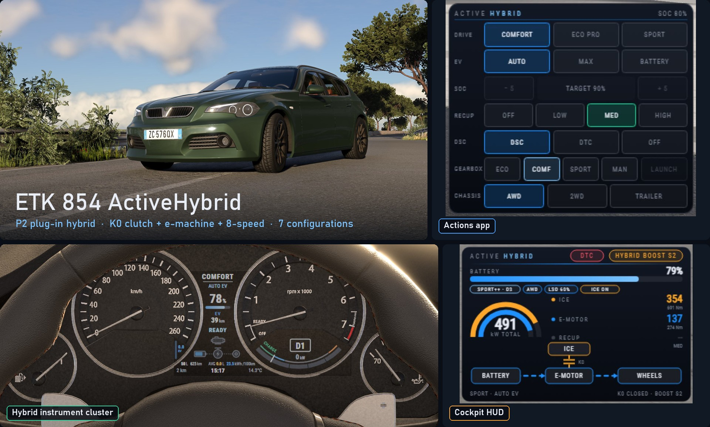
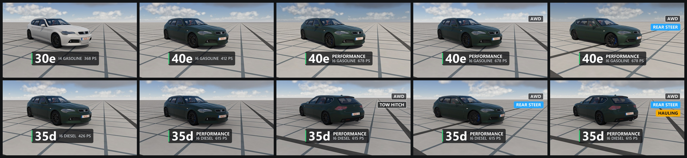
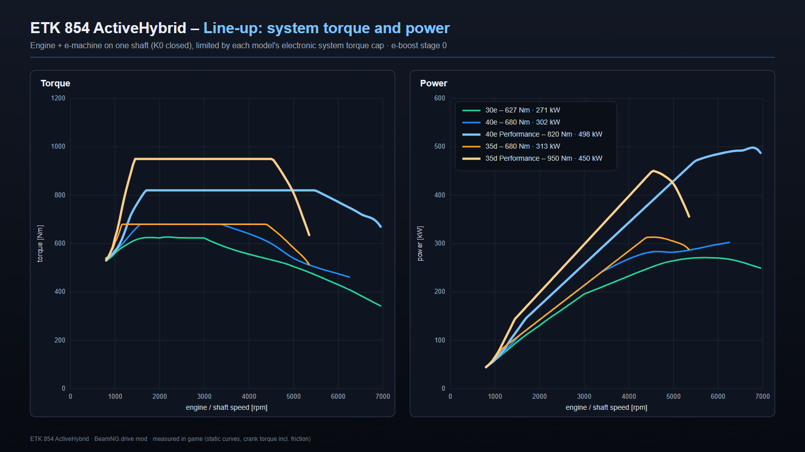
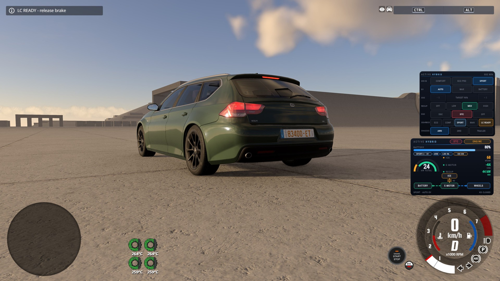
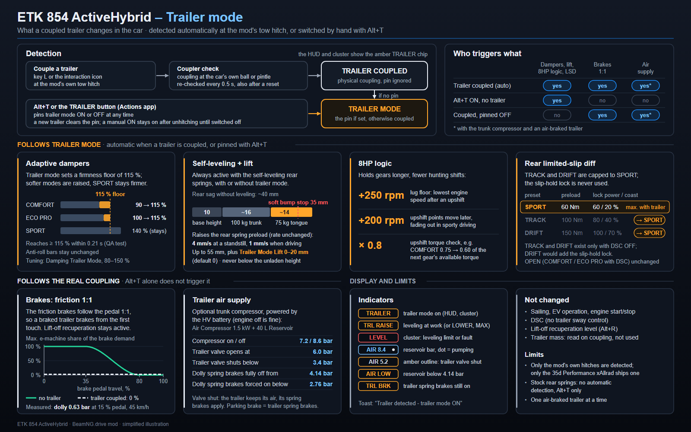
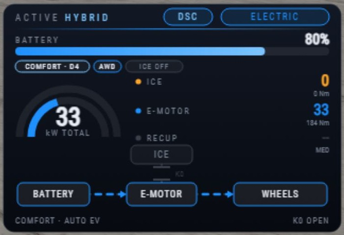
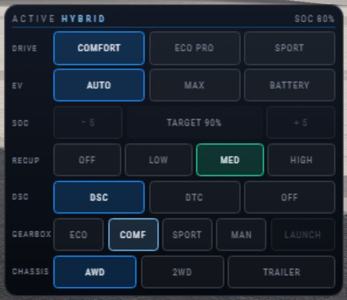

# ETK 854 ActiveHybrid: P2 plug-in hybrid wagon with 8-speed automatic and xAllrad

**P2 hybrid with K0 clutch and 8-speed, now with active rear-axle steering and trailer stability**

*ETK 854 ActiveHybrid at a glance: the exterior, the Actions app, the hybrid instrument cluster and the cockpit HUD*

## Quick start

1. **Get the mod:** download `etk_p2_hybrid_suite.zip` from the [latest release](https://github.com/WallnerK/beamng_etk-p2-hybrid-suite/releases/latest) and move it into your mods folder (`%LOCALAPPDATA%\BeamNG\BeamNG.drive\current\mods`) without unpacking it, or subscribe to it in the in-game repository.
2. **Activate it** in the mod manager.
3. **Optional, but recommended:** add the two UI apps **ETK 854 ActiveHybrid Cockpit** and **ETK 854 ActiveHybrid Actions** to your UI.
4. **Spawn** one of the ten configurations from the **ETK ActiveHybrid** tile in the vehicle selector (Ctrl+E) and enjoy.

**New in 1.1.0:** optional **active rear-axle steering**. Below about 60 km/h the rear wheels steer opposite to the front wheels (up to 3°, turning circle about 0.6 m smaller), above it in the same direction (up to 1.5°) for calmer lane changes. The DSC knows the rear angle, and a stability assist lets the rear wheels counter beginning oversteer. Two new models carry it, plus a **Hauling** model with a **trailer stability function** of the DSC, and the centre screen now has switchable views and a **control panel** you can click.

**The ETK 800 wagon as a plug-in hybrid with the control logic of a real one.** Between the engine and the 8-speed automatic sit a K0 disconnect clutch and an e-machine on the gearbox input shaft, the P2 layout of production plug-in hybrids. A dedicated hybrid control unit decides every frame whether the car drives electrically, sails, boosts or charges; it starts the engine on the move without a jolt and caps the combined torque so the car pulls like a real one. Ten configurations, three engine lines.

I drive a 535d Touring from the F-series myself, and many technical details of this mod are inspired by it: the twin-turbo diesel, the chassis tune, the self-leveling rear and the fuel figures I compare against. The drivetrain and its operating logic are modelled on BMW's plug-in hybrids: the two mode selectors, the engine start through the slipping K0, sailing, the recuperation levels and the torque cap follow how those cars work.

I built this mod with the help of Claude, but countless hours of my own time went into it, with two goals. First, a genuinely realistic P2 hybrid experience: engine, disconnect clutch and e-machine working together the way they do in a real car. That is the main difference to every other EV or hybrid mod I have seen. Second, to change that realistic P2 car the way I would have wished for from the factory: a six-cylinder whose e-machine is not there primarily to save fuel, but to reshape the engine's power curve for more driving fun.

This is a fan project; it is not affiliated with, endorsed by or connected to BMW AG or any other car or transmission manufacturer. Engine codes and mode names only describe what the simulation is modelled on; everything else in game is fictional or BeamNG's own.

## Highlights

- **Active rear-axle steering (new):** counter-phase below about 60 km/h, in-phase above, DSC with a corrected yaw reference, selector OFF / ON + DSC / ON NO DSC
- **Trailer stability (new):** sway damping in three stages and corner pre-braking, with the tow hitches; new **Hauling** model
- **Cockpit control panel (new):** centre-screen views ENERGY / MAP / TRAILER, four cluster views plus AUTO, a MENU panel you click or turn like a rotary controller
- **Real P2 hybrid:** engine → K0 clutch → e-machine → converter → 8-speed, the e-machine a true powertrain device
- **Two selectors:** Driving Experience (COMFORT / ECO PRO / SPORT) × EV mode (AUTO EV / MAX EV / BATTERY CONTROL)
- **Jolt-free engine starts** on the move, **sailing**, **four recuperation levels** up to **one-pedal driving**, **EV creep**
- **Launch control** with the e-machine as generator load: 0-100 km/h in 3.1 s (40e Performance xAllrad) to 4.6 s (30e)
- **8HP-style shift program** that plans with the hybrid, **DSC / DTC** on both power sources, **limited-slip rear differential**, **xAllrad** with 2WD mode
- **Adaptive dampers, self-leveling, trailer mode**, tow hitches and **trailer air supply**, **cooling package** with PWM fan
- **Hybrid cockpit:** HUD with live energy flow, Actions app, hybrid instrument cluster and centre screen
- **E-boost stages** up to 500 Nm / 200 kW

## The line-up

*The ten public configurations as their vehicle-selector thumbnails (1.1.0): petrol 30e / 40e models in the top row, diesel 35d models in the bottom row, each with its tier, engine and system power and feature badges (AWD, REAR STEER, TOW HITCH, HAULING).*

![Dark comparison card with seven rows in three groups: petrol four-cylinder (30e), petrol six-cylinder B58 (40e, 40e Performance, 40e Performance xAllrad) and diesel six-cylinder N57 (35d, 35d Performance, 35d Performance xAllrad). Each row lists the engine, the engine peak (30e 188 kW / 255 PS / 362 Nm, 40e 220 kW / 299 PS / 447 Nm, 40e Performance 415 kW / 565 PS / 704 Nm, 35d 230 kW / 313 PS / 637 Nm, 35d Performance 369 kW / 502 PS / 888 Nm; the xAllrad models as their RWD versions), and two horizontal bars on a shared grid. The top bar shows system power as engine peak in orange plus the 83 kW e-machine in blue (271 to 498 kW). The bottom bar shows torque at the gearbox input as engine torque in orange plus the 265 Nm e-machine in blue. Where that sum is above the system torque cap (680, 820 or 950 Nm), a red tick marks the cap and the trimmed electric part is hatched. Only the 30e stays below its cap (627 of 680 Nm). Further columns: drive (RWD, or AWD / 2WD on the xAllrad models), axle ratio (3.15 on the 30e, 2.81 on all others), weight (30e 1765 kg, 40e and 40e Performance 1805 kg, 40e Performance xAllrad 1850 kg, 35d and 35d Performance 1835 kg, 35d Performance xAllrad 1930 kg), value (63,500 to 89,400) and special equipment such as carbon-ceramic brakes, the Performance Cooling Package and the Heavy Duty Tow Hitch rated for 3.5 t. Each row also gives 0-100 km/h with launch control in SPORT + DTC: 30e 4.6 s, 40e 4.5 s, 40e Performance 4.2 s, 40e Performance xAllrad 3.1 s, 35d 4.5 s, 35d Performance 4.3 s, 35d Performance xAllrad 3.6 s. A footer panel lists what every configuration shares: the P2 module, 13.5 kWh battery, 50 l tank, limited-slip rear differential, DSC/DTC, adaptive dampers with rear self-leveling, and 245/40 R18 tyres.](docs/images/schematic-lineup.png)

*The seven ETK 854 ActiveHybrid configurations side by side, from the 30e entry model to the 35d Performance xAllrad: engine, engine peak and system output, drive, axle, weight, value, special equipment and 0-100 km/h with launch control. The bars show system power and the torque at the gearbox input against each model's system torque cap. Engine figures and 0-100 times are measured in game.*

All ten share the P2 module with an 83 kW / 265 Nm e-machine (e-boost stage 0), the 13.5 kWh battery, the 50 l tank, the limited-slip rear differential, DSC / DTC, the adaptive chassis and the hybrid cockpit.

| Configuration | Engine | Engine kW / PS / Nm | System kW / PS / Nm | Drive, axle | Weight | Value | Notes |
|---|---|---|---|---|---|---|---|
| **30e** | 2.0 l I4 turbo | 188 / 255 / 362 | 271 / 368 / 627 | RWD, 3.15 | 1765 kg | 63,500 | entry-level model, Pearl White |
| **40e** | B58 3.0 l I6 turbo | 220 / 299 / 447 | 303 / 412 / 680 | RWD, 2.81 | 1805 kg | 68,500 | default model |
| **40e Performance** | B58S, ttSport turbo | 415 / 565 / 704 | 498 / 678 / 820 | RWD, 2.81 | 1805 kg | 85,500 | carbon-ceramic brakes, Performance cooling |
| **40e Performance xAllrad** | as above | as above | as above | AWD / 2WD, 2.81 | 1850 kg | 89,400 | + xAllrad |
| **40e Perf. xAllrad Rear Steer** | as above | as above | as above | AWD / 2WD, 2.81 | 1850 kg | 92,200 | + xAllrad, rear-axle steering (new) |
| **35d** | N57D30TOP 3.0 l I6 twin-turbo diesel | 230 / 313 / 637 | 313 / 426 / 680 | RWD, 2.81 | 1835 kg | 72,200 | diesel instrument cluster |
| **35d Performance** | N57S, Stage 3 turbo | 369 / 502 / 888 | 452 / 615 / 950 | RWD, 2.81 | 1835 kg | 84,250 | carbon-ceramic brakes, Performance cooling |
| **35d Performance xAllrad** | as above | as above | as above | AWD / 2WD, 2.81 | 1930 kg | 88,150 | + xAllrad, heavy-duty tow hitch, trailer stability |
| **35d Perf. xAllrad Rear Steer** | as above | as above | as above | AWD / 2WD, 2.81 | 1886 kg | 88,900 | + xAllrad, rear-axle steering, no tow hitch (new) |
| **35d Perf. xAllrad Hauling** | as above | as above | as above | AWD / 2WD, 2.81 | 1995 kg | 91,960 | + xAllrad, rear-axle steering, 3.5 t heavy-duty hitch with ball and pintle hook, trunk air compressor, trailer stability (new) |

The selector tiles carry badges for tier, engine, power and features (AWD, REAR STEER, HAULING, TOW HITCH).

System power = engine peak + 83 kW (a nominal sum, so it follows the engine figures). System torque = the system torque cap, or engine + 265 Nm where that is lower.

**0-100 km/h with launch control** (SPORT + DTC, measured on smallgrid): 30e 4.6 s · 40e 4.5 s · 40e Performance 4.2 s · 40e Performance xAllrad 3.1 s · 35d 4.5 s · 35d Performance 4.3 s · 35d Performance xAllrad 3.6 s. The rear-wheel-drive models are limited by traction, which is why xAllrad is so much quicker. The Rear Steer and Hauling models are not measured yet.

*System torque and power of the five calibrations (engine + e-machine at e-boost stage 0, limited by the electronic system torque cap): 30e 627 Nm / 271 kW, 40e 680 Nm / 302 kW, 40e Performance 820 Nm / 498 kW, 35d 680 Nm / 313 kW, 35d Performance 950 Nm / 450 kW.*

## Rear-axle steering

The optional part replaces the stock rear suspension 1:1 and turns its two toe links into actuators. Below about 60 km/h the rear wheels steer opposite to the front wheels, up to 3°, so the turning circle shrinks by about 0.6 m. Above it they steer with the front wheels, up to 1.5° (SPORT 1.0°), so lane changes feel calmer. In trailer mode or with a trailer coupled the change-over moves down to 40 km/h and the counter-steer is limited to 1°.

The DSC knows the rear angle and corrects its yaw reference, so it does not mistake the tighter line for oversteer. With **ON + DSC** (default) a stability assist lets the rear wheels counter beginning oversteer before the DSC trims torque or brakes. **ON NO DSC** keeps the steering but no assist: the rear wheels return to straight while the DSC intervenes. **OFF** keeps the rear wheels straight, as without the system, and DSC OFF always switches the rear-axle steering off. The selector is the **R-STEER** row of the Actions app and the CHASSIS tab of the centre-screen panel.

Two models carry it from the factory: **40e Perf. xAllrad Rear Steer** and **35d Perf. xAllrad Rear Steer**, plus the Hauling model. On any other ActiveHybrid you can fit it in the rear suspension slot; I have only driven it on the xAllrad models so far.

## Trailer stability and the Hauling model

Both tow hitches now bring a trailer stability function of the DSC. It arms with trailer mode on and DSC or DTC; with a trailer coupled but trailer mode off, a hint tells you so. The hitch carrier works as a force sensor, and from it the car estimates the trailer mass and tongue load; with a low or negative tongue load the recommended speed drops from 100 to 80 km/h.

- **Sway:** stage 1 acts silently (rear-steer share, torque hold, no engine start or stop), stage 2 lights the lamp, takes the wheel torque away and brakes a single front wheel, stage 3 brakes the whole combination down and shows "Reduce speed". DTC keeps the sway damping.
- **Corners:** with DSC, the car predicts the lateral acceleration of a corner and, in two steps, holds the torque and then brakes before the combination runs out of grip.
- **Display:** a TRAILER page on the centre screen (drawbar load, estimated trailer mass) and a TSA chip in the HUD.

I retuned the trailer-mode DSC after my own drive with a 2.9 t cargo trailer: it held on too long and was a bit too sensitive. The low-friction memory now needs real traction control or ABS action, a corner step ends once the car is back below the limit, shorter lamp after an intervention, torque back after a corner step, "Reduce speed" only for a clear intervention, and a better trailer mass estimate.

The new **35d Perf. xAllrad Hauling** is the tow car of the range: rear-axle steering, the 3.5 t heavy-duty hitch with ball and pintle hook, the trunk air compressor for air-braked trailers, and trailer stability.

## Cockpit views and control panel

The centre screen switches between **ENERGY** (energy flow, changes to the trailer page by itself), **MAP** (the game's navigation map) and **TRAILER**. The cluster has the views **HYBRID**, **EFFICIENCY**, **SPORT** and **MINIMAL**; **AUTO** follows the Driving Experience. **MENU** opens a control panel on the centre screen with the tabs DRIVE, EV, CHASSIS, TRAILER and DISPLAY: everything the Actions app offers, plus shift program AUTO, trailer mode AUTO and a trip computer reset. Click a button on the screen with the mouse cursor, or use the keys like a rotary controller. A watchdog reloads a cockpit page that stops updating after a vehicle swap.

## What it changes on the ETK 800

![Cutaway side view of a generic estate car on a dark background, front to the left, with numbered callouts. 1 P2 hybrid module behind the engine (K0 clutch 1150 Nm, e-machine 265-500 Nm / 83-200 kW, torque converter lock-up 1520 Nm, 8-speed). 2 HV battery 13.5 kWh (150 kg) plus 50 l fuel tank under the rear seat. 3 engine ECUs with system torque cap 680 / 820 / 950 Nm. 4 cooling package at the front (radiator 5400 W/K, 850 W PWM fan, 101-105 °C at standstill). 5 multi-plate LSD rear differential. 6 dashed xAllrad transfer case with front propshaft (Performance xAllrad only). 7 adaptive dampers and rear self-leveling (up to 55 mm). 8 sport steering (450° instead of 510°). 9 sway bars 29 / 16 mm. 10 tow hitches (2.0 t EU, 3.5 t heavy duty). 11 workshop cargo with 1.5 kW air compressor and 40 l reservoir. 12 DSC / DTC parts. 13 instrument cluster and centre screen. 14 HUD and Actions apps, shown as a small inset. Fourteen cards below explain each callout and name the stock part it replaces. A bottom strip lists stock parts chosen differently (final drive 2.81, 245/40 R18 tyres, paddles, speed limiter delete, adaptive power steering, ttSport / Stage 3 turbo and carbon-ceramic brakes on Performance models) and states that body and interior stay stock and no base-game file is overridden.](docs/images/schematic-vs-stock.png)

*What the ActiveHybrid changes on the ETK 800: fourteen groups of new parts, from the P2 hybrid module and HV battery to the LSD, chassis, towing kit and cockpit displays. Every change hangs off an existing slot of the stock car, and no base-game file is overridden.*

- **Transmission:** the P2 module (K0, e-machine, converter, 8-speed, hybrid control) with an E-Boost Stage sub-slot
- **Fuel tank:** 50 l tank plus 13.5 kWh HV battery
- **Engine and driveline:** dedicated engine computers (ECUs) on the six-cylinders, no speed limiter, 2.81 axle on the six-cylinders, limited-slip rear differential, xAllrad transfer case
- **Chassis, DSC, cooling, cockpit:** adaptive dampers, self-leveling, sport steering, optional rear-axle steering, dedicated DSC parts, uprated radiator, hybrid cluster and centre screen with control panel
- **Towing:** EU or heavy-duty hitch, both with trailer stability, workshop cargo with an electric air compressor

Every change is a part in an existing ETK 800 slot or in a sub-slot of one of the mod's own parts (E-Boost Stage, tow balls, workshop cargo modules); no base-game file is touched; the rear-axle steering uses the stock rear suspension slot.

## Inside the mod

Twelve deep-dive chapters explain every system. In short:

**1. P2 hybrid drivetrain.** The e-machine sits on the gearbox input as a real powertrain device with its own inertia and energy accounting, so it uses all eight gears for pulling away and for recuperation. A system torque cap per engine computer protects the gearbox.

![Block diagram on a dark background. Top row: driver inputs (Driving Experience COMFORT / ECO PRO / SPORT, EV modes AUTO EV / MAX EV / BATTERY CONTROL, recuperation OFF to HIGH, DSC / DTC, launch control) feed the VCU. The VCU handles strategy, the engine start sequence CRANK-SYNC-ENGAGE-BLEND, the sportiness index, SOC bands, EV creep, launch control with a 290 Nm generator load, torque coordination and the system torque cap of 680 / 820 / 950 Nm plus 0 / 100 / 220 / 370 Nm per e-boost stage. Next to it sit the other controllers. Dashed control lines run to the drivetrain row: combustion engine table (30e I4 2.0 T 188 kW / 362 Nm, 40e B58 220 kW / 447 Nm, 40e Performance B58S 415 kW / 704 Nm, 35d N57 230 kW / 637 Nm, 35d Performance N57S 369 kW / 888 Nm, measured in game), K0 disconnect clutch 1150 Nm (open = EV), P2 e-machine with stages 0-3 (265 to 500 Nm, 83 to 200 kW), torque converter (stall 1.7, lock-up 1520 Nm), 8-speed automatic (4.714 to 0.667, 8HP logic programs), transfer case (RWD pass-through or xAllrad 3000 Nm clutch, AWD / 2WD), front axle 2.81 (xAllrad only) and rear axle 2.81 (30e 3.15) with a multi-plate LSD (OPEN, SPORT, TRACK, DRIFT). Coloured arrows show engine, electric, recuperation and crank flows. Bottom row: 50 l fuel tank, 850 W PWM electric fan fed from the battery, HV battery 13.5 kWh with discharge / charge limits of 95/55 to 225/95 kW per stage, an optional 1.5 kW air compressor, and a legend of the energy-flow states ELECTRIC, HYBRID / BOOST, SAILING, RECUPERATION and CHARGING.](docs/images/schematic-p2-drivetrain.png)

*The P2 drivetrain at a glance: the engine, the K0 clutch, the e-machine on the gearbox input shaft, the torque converter, the 8-speed automatic, rear-wheel drive or xAllrad, and the new limited-slip rear differential, with the VCU above and both energy stores below.*

**2. Operating strategy.** Driving Experience and EV mode are independent, with a clear precedence when their rules collide. In COMFORT and ECO PRO with AUTO EV the pedal has an electric zone you can feel, and the engine joins only when you kick down, keep asking for more, pass 110 km/h (ECO PRO 120 km/h) or the battery runs low; SPORT keeps the engine running, and MAX EV never starts it.

![Dark technical matrix. Three columns: AUTO EV (Alt+5, electric first), MAX EV (Alt+4, purely electric) and BATTERY CONTROL (Alt+B, charge to a target SOC of 10-100 %, default 90 %, then hold). Three rows: COMFORT (Alt+1), ECO PRO (Alt+2) and SPORT (Alt+3). Each row header lists the settings that stay the same in every EV mode: dampers 90 / 100 / 140 %, stability DSC / DSC / DTC, 8HP program COMFORT / ECO / SPORT, lift-off recuperation x1.00 / x0.90 / x1.20, rear LSD open / open / SPORT lock. Each cell lists pedal map, engine start and stop rules, sailing and charging. COMFORT + AUTO EV (presets AUTO and HYBRID): EV zone 0-45 %, engine from 70 % pedal, fastest start from 85 %, above 110 km/h or on sustained demand, off about 0.3 s after a calm lift. ECO PRO + AUTO EV: EV zone 0-80 %, full-EV plateau 80-85 % (HUD label EV FULL), band up to the torque cap, engine after about 2-4 s at 85-90 %, at once from 90 %, kickdown at 95 % held 0.12 s, above 120 km/h, never idles decoupled. MAX EV cells (preset EV): pedal over the e-machine alone (265 Nm / 83 kW at stage 0), engine never starts, below 8 % SOC the engine starts and the mode switches to AUTO EV. BATTERY CONTROL cells (preset HOLD): engine forced on below target minus 3 pp, also at a standstill; charging while driving up to 25 kW (about 10 kW at 85 km/h), quiet in P at about 2200 rpm, fastest in N at about 45-48 kW; no sailing below the target. In the SPORT row the AUTO EV and MAX EV cells are merged (preset SPORT): engine always on, e-machine as boost, 6th is the top gear, launch control. SPORT + BATTERY CONTROL keeps charging active. A bottom strip shows which rule wins when rules collide: SOC below 8 %, then BATTERY CONTROL, then the SPORT / HYBRID pin, then MAX EV, then standstill / creep, then the AUTO EV rules. A side panel lists the five presets with their pairs, the keyboard keys (Alt+F, Alt+E, Alt+M, Alt+PgUp/PgDn, Alt+R, Alt+G, Alt+K) and notes on the Actions app, DSC OFF, trailer damping and the 35d torque cap.](docs/images/schematic-mode-matrix.png)

*Two independent selectors, nine combinations: what the ETK 854 ActiveHybrid does for each pairing of Driving Experience (COMFORT / ECO PRO / SPORT) and EV mode (AUTO EV / MAX EV / BATTERY CONTROL). Row headers show the whole-car settings (dampers, DSC/DTC, 8HP program, lift-off recuperation, rear LSD). Each cell gives the pedal curve, engine start/stop rules, sailing and charging. A strip shows which rule wins when rules collide, and a side panel lists the five presets and their keys.*

**3. Engine start without a jolt.** Crank through the slipping K0, rev-match, close at a few rpm of slip, blend the torque over. A fill loop in the e-machine cancels the clutch torque 2000 times a second.

![Two time-aligned charts on a dark background. Left, "Engine start: OFF to ON": a phase bar EV, CRANK 266 ms, SYNC 377 ms, ENGAGE 208 ms, BLEND 803 ms, ON from 1.65 s, above three stacked plots. Speed: engine speed (orange) rises from 0, fires at 239 ms and 781 rpm, and reaches the flat 1545 rpm gearbox input speed (grey) at ENGAGE, where it is 30 rpm higher. K0 capacity (light blue): it ramps to 89 Nm during CRANK, is 0 in SYNC, and closes to the 1150 Nm lock torque during ENGAGE (dashed, schematic). Torque: the e-machine (blue) jumps to 192 Nm during CRANK, which is about 100 Nm of drive plus 91 Nm of fill, while the K0 drags −90 Nm to spin the engine. During BLEND the engine torque (orange) rises from 0 to about 100 Nm as the e-machine falls to 0. The total drive torque (pale band) stays flat at 95–100 Nm next to the dashed command. Right, "Shut-down": phases ON, RELEASE (TORQUE) 647 ms, RELEASE (OPEN) 331 ms and OFF at 74 km/h. The engine torque falls from 69 to 0 Nm as the e-machine rises to 67 Nm, total about 66 Nm. The K0 stays locked and then opens at 3/s, and the ignition is cut only after the K0 is open, at 978 ms. Five cards at the bottom explain each phase and give QA medians.](docs/images/schematic-ice-start.png)

*A measured rolling engine start in COMFORT. The e-machine cranks the engine through the slipping K0 (266 ms). The engine is then rev-matched with the clutch open (377 ms), and the K0 closes with −1 rpm slip at the bite (208 ms). Finally the torque is handed over in 803 ms, and the drive torque stays within 6.2 Nm of the command throughout. The shut-down runs the same steps backwards, and the ignition is cut only after the K0 is open.*

**4. Sailing and recuperation.** Each `Alt+R` level is a deceleration that feels the same in every gear, from sailing with the engine off to one-pedal driving with hold. Brake-pedal recuperation blends with the friction brakes without changing the pedal feel.

![Two-panel dark technical diagram. The left panel has four cards for the recuperation levels: OFF 0 m/s² (sailing allowed, K0 open, engine off), LOW 0.5 m/s² (like engine braking in a high gear), MED 1.2 m/s² (like a hybrid's B position, the default) and HIGH 2.2 m/s² (one-pedal driving with a friction top-up and a hold below 1.5 km/h). Each card shows a QA measured value (0.21 / 0.70 / 1.39 / 2.30 m/s² including drag). A line chart of deceleration against gear 1st to 8th shows the green level targets as flat lines, while a red dashed line for a fixed 100 Nm motor torque falls from 2.12 m/s² in 1st to 0.30 m/s² in 8th. Below it, a table lists the e-machine torque the VCU commands per gear for each level, and values above the 300 Nm limit are highlighted. The right panel is a signal-flow diagram. The brake pedal demand and a chart of the e-machine share (100 % up to 35 % pedal, tapering to 0 at 80 %) feed into the deceleration target, then torque for this gear, then limits, then the e-machine. The measured torque that really reaches the wheels is subtracted from the pedal demand, and the friction brakes add the rest. A dashed trailer box shows that with a trailer coupled the e-machine share is 0 %, so the friction brakes follow the pedal 1:1 to both the car's and the trailer's brakes, measured at 0.63 bar dolly service brake.](docs/images/schematic-recuperation.png)

*Recuperation in the ETK 854 ActiveHybrid: each Alt+R level is a lift-off deceleration (0 / 0.5 / 1.2 / 2.2 m/s²) that feels the same in every gear. On the brake pedal the e-machine brakes first and the friction brakes add the rest. With a trailer coupled, the friction brakes follow the pedal 1:1.*

**5. Launch control.** The converter is preloaded against the brakes to three quarters of what the car can hold, while the e-machine loads the engine as a generator so the turbo spools before the car moves. In every mode, a brake-throttle guard stops brake plus throttle from pushing the car through its brakes.

*Launch control READY: the e-machine works as a generator load so the engine builds boost against the brakes*

**6. 8HP-style shift program.** It plans with system torque, holds the gear while the K0 closes onto the engine and picks the gear the engine needs before the engine runs. ECO and COMFORT cruise at low revs; SPORT stays out of the overdrives: 6th is its top gear, 7th only when cruising relaxed.

![Two line charts side by side, petrol (40e, B58) on the left and diesel (35d / 35d Performance) on the right. The x axis is load u from 0 to 1; the y axis is engine rpm right after an upshift, from 800 to 5600 rpm. ECO (teal) and COMFORT (white, with a dashed COMFORT+ line) rise gently from about 1100 rpm (petrol) or 1050 rpm (diesel) and sit inside a shaded torque-first band: 1100–1900 rpm (petrol) and 1050–1520 rpm (diesel) up to u 0.70. SPORT (red, solid at its base adaptation, dashed for SPORT++) runs much higher, 2870–3500 rpm at half load on petrol. An annotation says: 'SPORT: top gear 6th – no overdrive'. A grey bar at u = 1 marks the full-load upshift range for each gear pair: 4067–5118 rpm (petrol, 6100 rpm shift point) and 3267–4111 rpm (diesel, 4900 rpm). There are three cards below the charts. The first explains the torque-first logic: early upshifts, a downshift only once system torque runs out, and the 35d at 60 % pedal shifting 1→2 at 2751 instead of 4876 rpm. The second has a light-load cruise table: COMFORT 6th/8th/8th/8th and SPORT 4th/6th/6th/7th (relaxed) at 50/80/100/130 km/h. The third explains how to read the axes, the EV bonus, the trailer offset and the Shift Map Offset slider.](docs/images/schematic-shift-map.png)

*Upshift lines of the 8HP-style shift program. ECO and COMFORT shift up early and stay in a narrow torque-first band of about 1100–1900 rpm (diesel 1050–1520 rpm) up to 70 % load. SPORT shifts much higher and keeps 6th as its top gear, with no overdrive. Every point is capped at the full-load upshift speed of its gear pair.*

**7. Driving dynamics.** Two-stage DSC trims engine and e-machine before it brakes a wheel. The rear differential's lock follows the Driving Experience, the DSC step and AWD/2WD, up to a full drift lock; the xAllrad models switch to 2WD at any time. With rear-axle steering, the DSC uses a yaw reference that includes the rear angle.

![Dark technical matrix. Rows: COMFORT, ECO PRO (both select DSC automatically) and SPORT (selects DTC). Columns: DSC, DTC, DSC OFF, each split into RWD models, xAllrad 2WD and xAllrad AWD. COMFORT and ECO PRO share their cells: with DSC OPEN (0 Nm, 0 %, 0 %, behaves like the stock open differential, marked DEFAULT), with DTC SPORT (power 60 %, coast 20 %, pre-load 60 Nm, no slip hold), with DSC OFF TRACK (80 %, 40 %, 100 Nm). SPORT row: with DSC SPORT. With DTC and rear drive, SPORT plus a slip hold of up to 1000 Nm (DEFAULT); with AWD, SPORT without hold (DEFAULT). With DSC OFF and rear drive, DRIFT (100 %, 70 %, 150 Nm) plus slip hold, with the handbrake freezing the hold; with AWD, TRACK. A legend shows the HUD chips LSD 60% in blue (SPORT), LSD 80% in amber (TRACK) and LSD 100% in red with a dot (DRIFT, dot = slip hold above 50 %, chip hidden in OPEN), and explains lock rate, power/coast and the stock brake EDL. Lower cards: a line chart of extra lock against axle slip (0 Nm below 6 %, rising to 1000 Nm at 15 %), with the hold timing (builds up at 6 /s, held 0.25 s, released at 2 /s, drops at 10 /s on ABS, DSC braking or brake at 30 % or more). A card on ABS and DSC braking: pre-load at most 20 Nm, coast 0 %, opens 100 % to 0 % in 50 ms, QA 0.039 s / 0.041 s, trailer mode caps to SPORT. A dashed side note: below about 2.5 km/h with the brake held or launch control armed the lock opens fully and the HUD shows LSD 0%, which is intended.](docs/images/schematic-lsd-matrix.png)

*The rear limited-slip differential picks its lock from Driving Experience, DSC step and drive mode: open in COMFORT / ECO PRO with DSC, 60 % in SPORT or DTC, 80 % TRACK with DSC OFF, and a 100 % DRIFT lock plus up to 1000 Nm of slip hold in SPORT + DSC OFF with rear drive. ABS and DSC braking open it within 50 ms, and it opens fully while the car is held at a standstill.*

**8. Chassis.** Adaptive dampers follow the Driving Experience in fine steps, and springs, anti-roll bars and steering are retuned for the heavier car without upsetting its balance.

**9. Towing.** Now you have basically unlimited torque, so of course you have to put it to use hauling ridiculous loads. Couple a trailer and the dampers, gearbox, differential and brakes adapt, while self-leveling keeps the rear level. For the really silly stuff there is an optional part that mounts an air compressor, powered by the HV battery, in the boot. Hook the game's dolly, or any other air-braked truck trailer, to the **pintle hook** of the heavy-duty hitch's combination mount, and the air supply connects with the coupling, just like a truck's gladhands. The air system is realistic: every brake application draws on the reservoir, the compressor kicks back in at 7.2 bar, and if the pressure drops below 3.4 bar the trailer's spring brakes clamp on. Since 1.1.0 the DSC also damps trailer sway and pre-brakes for corners (see above).

**10. Cooling.** An 850 W PWM fan stays off until 105 °C, then starts audibly and holds 101-105 °C while charging at a standstill. The Performance models add ram-air auxiliary radiators and an oil cooler.

![Dark technical schematic, four parts. Main line chart: fan duty (0-100 %) against coolant temperature (95-123 °C). While heating up, the duty is 0 until 105 °C, jumps to 35 %, stays flat to 106.8 °C, then rises 12.5 % per K to 100 % (850 W) at 112 °C. While cooling down, 35 % is held down to 101 °C (after at least 30 s of running), so a shaded band from 101 to 105 °C marks the standstill regulation band. A grey dashed loop shows driving above about 22 km/h: the fan stays off until 110 °C and switches off again below 108 °C. From 114 °C a red-tinted zone marks the base-game fan stage taking over as a failsafe, and above 120 °C the coolant boils over. A strip above the chart shows steam wisps at standstill: faint from 106 °C (fan on), light from 110 °C, heavy from 115 to 119 °C. A right-hand axis maps duty to the HUD chips FAN 1/2/3. White dots mark points measured in game. Top-right panel: measured standstill-charging cycle on the B58 at 15 °C. The fan runs 51 s and pulls the coolant from 106.4 to 101.0 °C, stays off 67 s until 105.0 °C, about 43 % on-time, up to 29.4 kW of extra cooling. Middle-right table for 35/50/75/100 % duty: coolant 105-106.8/108/110/≥112 °C, airflow 2.85/3.35/4.17/5.0 m/s, fan power 158/256/495/850 W, drawn from the battery 176/284/550/944 W, extra cooling at standstill 29.1/41.5/60.4/78.6 kW, HUD FAN 1/1/2/3. Bottom panel on the Performance cooling package. An offline replica of 600 s at full load: with the standard package the coolant passes 120 °C after 15-47 s (B58S) and 23-215 s (N57S); with the Performance package there is no event. The package adds a 4600 W/K auxiliary radiator that uses ram air only and a 240 W/K oil cooler that opens at 110 °C oil. A line chart of radiator capacity against road speed shows Performance 7874, standard 4252 and stock ETK 3496 W/K at 250 km/h, the same at standstill, and +85 % at speed.](docs/images/schematic-cooling.png)

*The 850 W PWM radiator fan stays off until 105 °C, starts at 35 % straight away and rises steplessly to 100 % at 112 °C. At standstill it holds the coolant between 101 and 105 °C, and on the move it stays off until 110 °C. The Performance models add an auxiliary radiator fed only by the airflow while driving, plus an oil cooler, for long full-throttle runs. These figures come from an offline replica of the game's thermal model; the in-game test is still pending.*

**11. Cockpit.** One picture and one colour code on every screen: HUD, Actions app, a cluster with READY needle and on-board computer, and an energy-flow centre screen. Since 1.1.0 both displays have switchable views, and the centre screen has a control panel.

*Electric driving: K0 open, engine off (40e Performance xAllrad)*

**12. Under the hood.** Tuning reference, about 230 data channels for your own apps, the failsafe, and how it was tested: an in-game QA suite (36 tests since 1.1.0), scripted scenarios and three feedback rounds.

![Block diagram on a dark background. The top panel, labelled 'VCU · hybridControl', holds 14 numbered steps arranged as a snake. Row 1, left to right: 1 Inputs, 2 Battery monitor, 3 E-machine envelope (stage caps 265/320/400/500 Nm, rev guard), 4 Pedal map (ECO PRO EV zone 80 % plus a full-EV plateau), 5 Sportiness index. Row 2, right to left: 6 Start/stop policy, 7 Sailing (25-160 km/h, SOC at least 10 %), 8 ICE arbiter + start sequencer (CRANK, SYNC, ENGAGE, BLEND; sole owner of K0, ignition and starter), 9 Launch control (generator load up to 290 Nm, brake-throttle guard), 10 Torque coordinator. Row 3, left to right: 11 EV creep, 12 Recuperation (OFF/LOW/MED/HIGH = 0/0.5/1.2/2.2 m/s²), 13 BATTERY CONTROL (default target 90 %, up to 25 kW on the move, P quiet / N fast), 14 Outputs (launch hold outputs written last, display channels at 20 Hz). A dashed red failsafe box says that if step 8 or 10 fails to load, the engine runs, K0 stays closed and the e-machine leads under the system cap. Coloured side strips mark the domain: electric blue, engine orange, recuperation green, sailing light blue. Below it a blue bar is labelled 'electrics data bus · electrics.values · about 230 etk854hybrid_* channels'. The VCU reads pedal, brake, wheel speed, rpm and the 8HP torque factor from the bus and writes actuator channels to it. Under the bus sit three groups. Powertrain devices (physics, 2 kHz): Engine, K0 clutch, E-machine (own device with a per-tick fill loop and creep floor), Converter + 8-speed. Satellite controllers: 8HP logic, DSC parts, LSD lock scheduler, xAllrad mode, Self-leveling, Adaptive dampers, Cooling, Air compressor, Display data. Displays: HUD app, Actions app, Instrument cluster, Centre screen. Arrows run from Display data to the cluster and centre screen. Dashed command arrows run from the Actions app back to the satellites and to the VCU.](docs/images/schematic-software.png)

*Inside the hybrid control software: the VCU runs 14 steps in a fixed order every frame, from inputs to outputs, and shares about 230 channels on the electrics bus with the powertrain devices, nine satellite controllers and the HUD, cluster and centre screen.*

## Controls

| Key | Function |
|---|---|
| Alt+1 / 2 / 3 | COMFORT / ECO PRO / SPORT |
| Alt+F / Alt+E | cycle Driving Experience / EV mode |
| Alt+5 / 4 / B | AUTO EV / MAX EV / BATTERY CONTROL |
| Alt+PgUp / PgDn | target charge ±10 % |
| Alt+R | recuperation OFF / LOW / MED / HIGH |
| Alt+K | launch control |
| Alt+G | shift program AUTO / ECO / COMFORT / SPORT / MANUAL |
| Alt+M | presets |
| Alt+T / Alt+W | trailer mode / xAllrad AWD or 2WD |
| Alt+H | centre-screen control panel (MENU) open / close |
| Alt+, / Alt+. | control panel: rotate left / right |
| Alt+J / Alt+Backspace | control panel: press / back |
| Alt+V / Alt+C | centre-screen view / cluster view |
| Ctrl+Q | DSC / DTC / DSC OFF (game key) |

All actions can be rebound under Options > Controls ("ETK 854: ..."), and almost all are a click in the Actions app or on the centre-screen panel. The rear-axle steering has no key: select OFF / ON + DSC / ON NO DSC in the Actions app's **R-STEER** row or on the panel's CHASSIS tab.

*The Actions app: every hybrid function at a click*

## Requirements and installation

**BeamNG.drive 0.40.3** (tested), no other mods needed.

1. Subscribe in the repository, or copy **etk_p2_hybrid_suite.zip** into `%LOCALAPPDATA%\BeamNG\BeamNG.drive\current\mods` **without unpacking it**. Updates keep this name; remove older forum versions (etk854_activehybrid_v1.0.x.zip).
2. Enable the mod in the mod manager (a game update disables all mods once).
3. Vehicle selector (Ctrl+E) → tile **"ETK ActiveHybrid"**.
4. The UI layout loads automatically. If an app is missing, add "ETK 854 ActiveHybrid Cockpit" or "ETK 854 ActiveHybrid Actions" from the app menu.

## Known limits

- On the 35d at low revs, pedal travel above roughly 80 % (COMFORT) or 67 % (SPORT) adds no torque: the system torque cap is reached.
- Reverse is limited to about 35 km/h on purpose.
- The hybrid UI layout stays after switching to another vehicle, and every spawned ActiveHybrid (also a second or AI car) switches to it.
- Sailing, EV driving and engine start/stop ignore a trailer, except while the trailer stability intervenes.
- Trailer stability works only with trailer mode on and DSC or DTC; corner pre-braking only with DSC.
- With a trailer, a brisk turn-in can still give a short pre-braking pulse with the DSC lamp. The last two trailer-stability corrections (ending a corner step in a held bend, the torque limit after a late corner step) are checked offline and in the QA suite, not yet on a long drive.
- After a vehicle reload with a trailer coupled, the estimated trailer mass appears only after new samples.
- Rear-axle steering: the turning-circle figure is calculated; I have not measured it in game yet.
- The control panel takes clicks only while the mouse cursor is visible and no UI app covers the centre screen. After the watchdog reloads a page, the MAP view shows no roads until the vehicle is reloaded (Ctrl+R).
- Trailer air: one air-braked trailer at a time; the round-3 protection valve is verified in simulation only.
- When the e-machine is saturated, the 12 V starter takes over the engine start: later, but no harsher. A kickdown out of EV takes about 0.9-1.0 s until the engine is coupled (about 1.1 s when the starter has to step in).
- Around an engine start the gearbox occasionally takes a gear back.
- Performance models: their full-throttle cooling is designed offline; sustained full-throttle runs in game and their fuel consumption are still pending.
- The 40e uses about 20 % more fuel than the real car it is modelled on; electric range is not measured.
- The LSD drift scenarios are still on the test plan; "LSD 0%" while the car is held at a standstill is intended.
- Changed units reach the cluster only after a reload; the trip computer is reset on the panel's DISPLAY tab.

## Credits and licences

- **Mod:** Deuflhard
- **Base vehicle, engines, sounds, tow hitch and cargo models:** base game by BeamNG GmbH
- Contains modified BeamNG code under the bCDDL 1.1.
- The inline e-machine device builds partly on motorShaft.lua by NiZhaZi (NZZ) from the "E-CVT Hybrid Vivace" mod, MIT License, [github.com/NiZhaZi/Beamng_Hybrid_and_EV_Mod](https://github.com/NiZhaZi/Beamng_Hybrid_and_EV_Mod). Thank you!
- Engine codes, the 8HP shift-logic name and the mode names ActiveHybrid and ECO PRO only describe what the simulation is modelled on; no affiliation with their owners.

**How it all works:** the technical deep dive (twelve chapters, every system explained) is in the [wiki](https://github.com/WallnerK/beamng_etk-p2-hybrid-suite/wiki).

## Changelog

See [CHANGELOG.md](CHANGELOG.md).

## Source and licence

The folder [`mod/`](mod) holds exactly the files of the release zip (drop-in mod structure `settings/`, `ui/`, `vehicles/`). Own work is licensed under [CC BY-NC-SA 4.0](LICENSE.md); BeamNG-derived code stays under the bCDDL 1.1; see [LICENSE.md](LICENSE.md) and [CREDITS.md](CREDITS.md).
